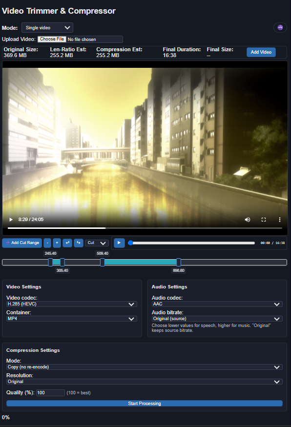
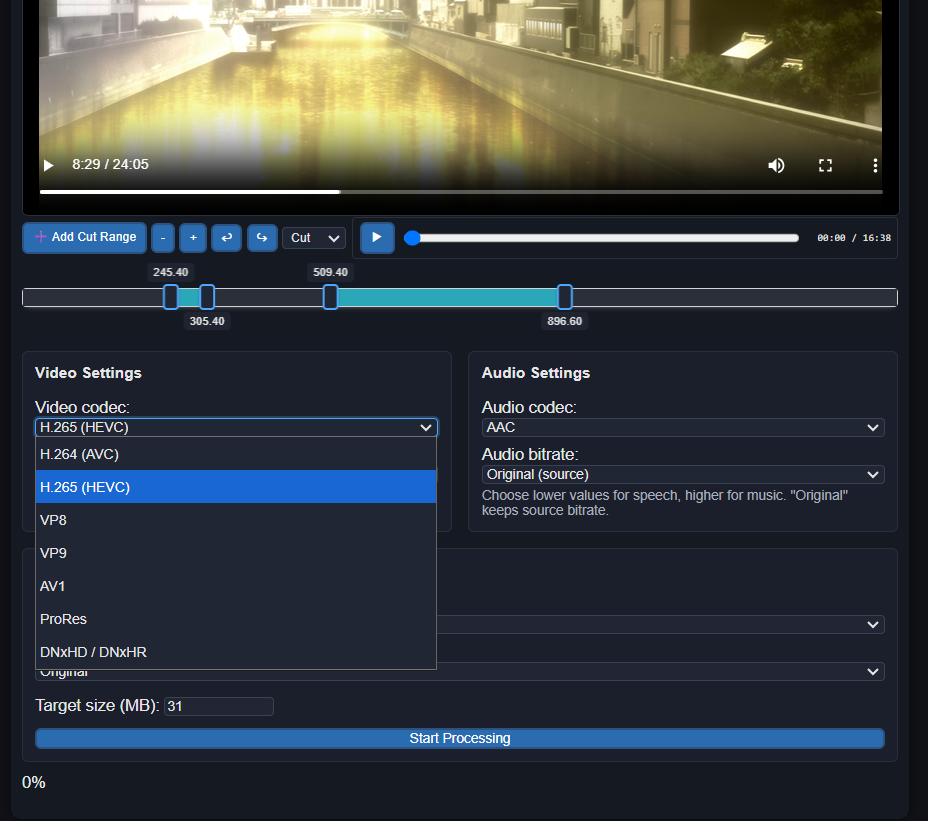
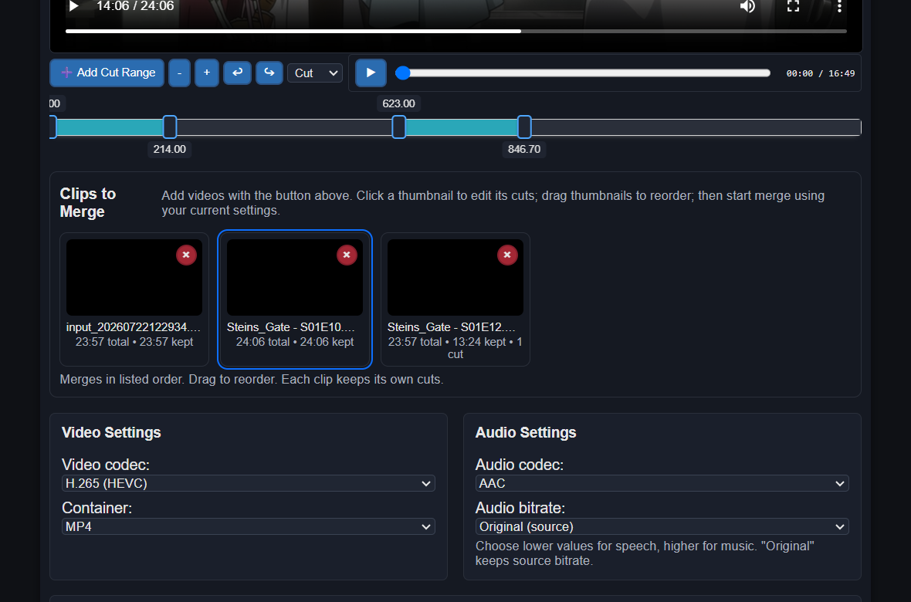
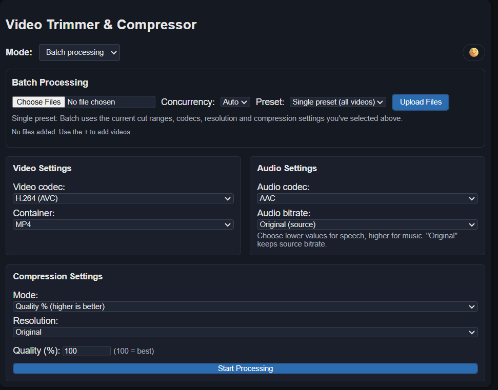

# Video Trimmer & Compressor

A Flask-based web application for trimming, multi-cut editing, previewing, and compressing videos using FFmpeg with customizable codecs, quality, and export settings..
## Main Interface



## Video and audio codec Changer



## Video Merger



## Batch processing 




## Prerequisites

**FFmpeg is required** for this application to work. The app will display an error message if FFmpeg is not installed.

### Installing FFmpeg on Windows

#### Option 1: Automated Installation (Recommended)
1. Run the provided `setup.bat` script in this folder
2. Choose option 1 for automatic download and installation
3. The script will download FFmpeg and add it to your PATH automatically
4. Restart your terminal/PowerShell after installation

#### Option 2: Using Chocolatey
1. Open PowerShell as Administrator
2. Install Chocolatey if you haven't already:
   ```powershell
   Set-ExecutionPolicy Bypass -Scope Process -Force; [System.Net.ServicePointManager]::SecurityProtocol = [System.Net.ServicePointManager]::SecurityProtocol -bor 3072; iex ((New-Object System.Net.WebClient).DownloadString('https://community.chocolatey.org/install.ps1'))
   ```
3. Install FFmpeg:
   ```powershell
   choco install ffmpeg
   ```
4. Restart your terminal/PowerShell

#### Option 3: Manual Installation
1. Go to https://ffmpeg.org/download.html
2. Download the Windows release build
3. Extract the downloaded archive
4. Add the `bin` folder to your system PATH environment variable
5. Restart your terminal/PowerShell

#### Option 4: Using Windows Package Manager (winget)
If you have Windows Package Manager installed:
```powershell
winget install Gyan.FFmpeg
```

### Verifying Installation
After installation, verify FFmpeg is working:
```powershell
ffmpeg -version
ffprobe -version
```

## Usage

1. Install the required Python packages:
   ```bash
   pip install flask
   ```

2. Run the application:
   ```bash
   python app.py
   ```

3. Open your browser and go to `http://127.0.0.1:5000`

4. Upload a video file and use the timeline slider to select segments to keep

5. Click "Trim & Compress" to process the video

## Features

- Web-based interface for video trimming
- Timeline slider for precise segment selection
- Real-time video preview
- Live "Final Output Preview" player that lets you scrub & play only the kept (non-cut) portions before exporting (Play/Pause + seek slider that automatically skips cut ranges)
- Video, audio codec, container changer and converter.
- Batch processing (concurrency control, single preset/ individual preset for each video)
- Video merger (single preset/ individual preset for each video)
- Video compression with configurable CRF
- Dark mode
- Automatic cleanup of temporary files
- Error handling and user feedback

## Troubleshooting

### "FFmpeg is not installed" error
- Make sure FFmpeg and FFprobe are installed and accessible from the command line
- Restart your terminal after installation
- Check that FFmpeg is in your system PATH

### File processing errors
- Ensure the video file is in a supported format
- Check that you have sufficient disk space
- Verify the video file is not corrupted

### Performance issues
- Large video files may take time to process
- Consider using a lower CRF value for faster processing (at the cost of larger file size)
- Ensure you have sufficient RAM and CPU resources

### Project Structure
```
video-trimmer-compressor/
│
├── app.py
├── requirements.txt
├── setup.bat
├── README.md
├── static/
└── templates/
```
